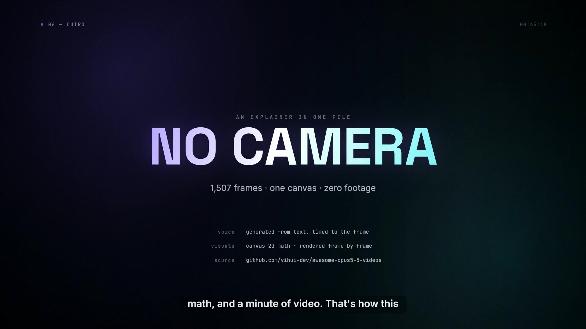

# No Camera

**A 50-second explainer with no footage in it.** Every frame is drawn by
[`video/src/anim.js`](video/src/anim.js) as a pure function of time, rendered
through a Skia canvas into ffmpeg, and narrated by an AI voice that is itself
laid onto the timeline by the same file.

▶︎ **Watch:** [`video/out/no-camera.mp4`](video/out/no-camera.mp4) · 1920×1080 · 30 fps · 0:50



---

## What it says

> This video has no camera. No actors, no footage. Just code, running at thirty
> frames a second. […] Here's the trick — a video is really just a picture,
> repeated. The only thing that changes between frames is time. So instead of
> filming, you write a function. Give it a moment, and it hands you back a
> frame. […] Sound works the same way. […] Then the frames march into an
> encoder, thirty per second, and come out the other side as one single video
> file.

## Why it exists

It is a remake in the spirit of
[yihui-dev/awesome-opus5-5-videos](https://github.com/yihui-dev/awesome-opus5-5-videos)
— a collection of videos made by *writing the animation as code* (HTML, Canvas,
SVG, Three.js) instead of filming or generating footage. This one is built from
scratch, end to end: canvas math for the picture, generated speech for the
voice, ffmpeg for the encode.

- **Visuals** — one file, ~1,300 lines of Canvas 2D. Six scenes, a shared design
  system (Inter, Space Grotesk, JetBrains Mono on near-black), film grain,
  a vignette and a slow 1.4% push-in.
- **Voice** — six narration clips generated from text with a young male
  explainer voice, then placed at exact frame times. The waveform in scene 4 is
  the *real* envelope of that voice, not decoration, and the syllable ticks are
  its actual peaks.
- **Sync** — picture and sound can't drift: `anim.js` owns `STARTS`, `TOTAL`
  and `drawFrame(ctx, t)`, and the renderer, the audio mix and the browser
  player all import from it.

## Run it

```bash
cd video
npm install                 # @napi-rs/canvas
node serve.mjs              # → http://localhost:4173  (live player, scrub it)
```

Rebuild the MP4 (needs `ffmpeg` on PATH):

```bash
cd video
./build.sh                  # frames → out/video-silent.mp4 → out/voice.wav → out/no-camera.mp4
node src/render.mjs --still 28.4     # single frame, for reference
```

## Files

| Path | What it is |
| --- | --- |
| `video/src/anim.js` | The whole film. `drawFrame(ctx, t)` — no assets, no state. |
| `video/src/audio.js` | Real peak envelope of the narration (520 buckets) + clip lengths. |
| `video/src/render.mjs` | Draws 1,507 frames, pipes raw RGBA into ffmpeg. |
| `video/src/mix.mjs` | Places the six clips at their frame times, normalises to −15 LUFS. |
| `video/build.sh` | Full build. |
| `video/index.html` + `video/serve.mjs` | Live player in the browser. |
| `video/audio/vo-0*.mp3` | The generated narration. |
| `prompts/no-camera.md` | The prompt, in the shape that collection uses. |

## Credits

Visuals and edit: generated code. Narration: AI-generated voice. Inspiration and
format: [awesome-opus5-5-videos](https://github.com/yihui-dev/awesome-opus5-5-videos).
