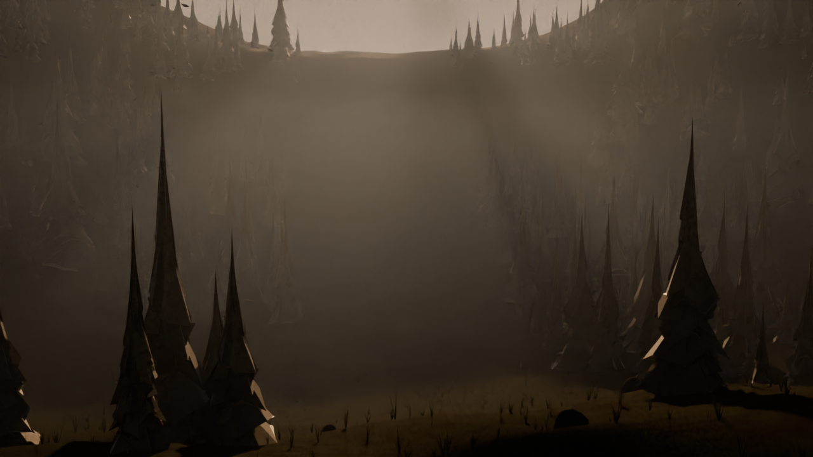

# Mist Valley — a procedural 3D short

A 4-second, 720p, path-traced shot of a conifer valley at dawn: layered forest
receding into blue mist, a low sun burning through the gap, and a slow camera
drift along the rim. Rendered with **Blender 5.0 / Cycles on CPU** — no GPU, no
display server, no downloaded assets. Every tree, ridge, grass blade and wisp of
mist is generated from code in [`valley.py`](valley.py).



## Render

```bash
./tools/setup_env.sh        # ~30s: installs bpy + builds headless shims
./tools/render.sh --look    # 3 cheap 480x270 preview stills
./tools/render.sh --all     # full 1280x720 sequence + MP4 encode
```

Tunable via env vars: `VALLEY_RES_X`, `VALLEY_RES_Y`, `VALLEY_SAMPLES`,
`VALLEY_FRAMES`, `VALLEY_SEED`, `VALLEY_MIST`, `VALLEY_OUT`.
Append `VALLEY_SINGLE=42` to render one frame, or `VALLEY_STILLS=1,48,96` for
specific preview frames.

## How it renders with no GPU

`bpy`'s shared libraries link against `libGL`, `libXrender`, `libXi` and
`libxkbcommon`, none of which exist in a bare container. `tools/setup_env.sh`
generates empty ELF shims for them and self-heals by adding whatever symbol the
dynamic loader complains about next, until `import bpy` succeeds. Cycles then
renders on the CPU and never touches the stubs. That is what makes real
path-traced animation possible here instead of expensive frame-by-frame waits.

## Scene notes

- **Terrain** — a valley heightfield: basin along +Y, walls rising at the flanks,
  ridges receding into the distance, all from layered `noise.noise` octaves.
- **Conifers** — a unit fir mesh built from drooping foliage skirts with
  per-vertex noise, so silhouettes read as ragged needles rather than cones.
  ~1,500 instances across four depth bands, with a cleared corridor down the
  valley axis so the light reads.
- **Mist** — one scattering volume whose density is the product of a height
  band (pooling in the basin), a distance ramp (thin near the lens, thick far
  away) and two drifting noise octaves. Anisotropy 0.62 for forward scatter,
  which is what makes the sun bloom instead of just glow.
- **Light** — a warm sun low in the gap plus a large cool sky fill; the warm/cool
  split is what stops a fog-heavy frame reading as flat sepia.

## Performance

Measured on 2 CPU cores: `time ≈ 9s + 6.0 × megapixels × samples`. The final
shot used 1280×720 at 8 samples with adaptive sampling (threshold 0.04), which
lands around a minute per frame.

## Files

| Path | What it is |
| --- | --- |
| `valley.py` | The shot: scene, materials, lighting, camera, compositor |
| `tools/setup_env.sh` | Headless Blender environment bootstrap |
| `tools/render.sh` | Preview / render / encode pipeline |
| `forest.py` | Earlier interior-forest experiment (kept for reference) |
| `render/mist-valley.mp4` | The finished shot |

---

## Also in this repo

### Can you build AI models from scratch? (`from_scratch/`)

An autograd engine, a transformer, a stock-market analyser and an honest
backtest — all in NumPy, no ML frameworks. [Read it here](from_scratch/README.md).

```bash
./tools/setup_scratch.sh
.venv/bin/python from_scratch/check_grad.py    # gradient checks on every op and model
.venv/bin/python from_scratch/finance.py       # 4 models vs the theoretical ceiling
```
