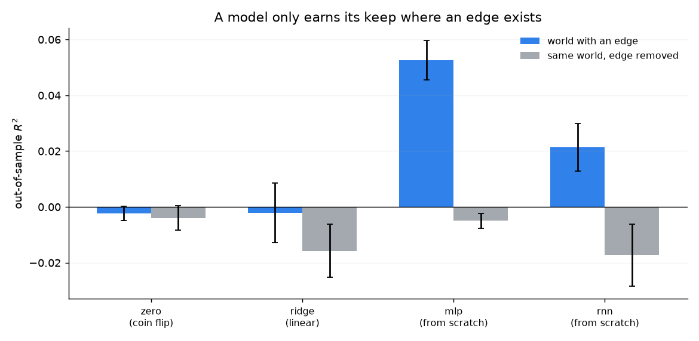
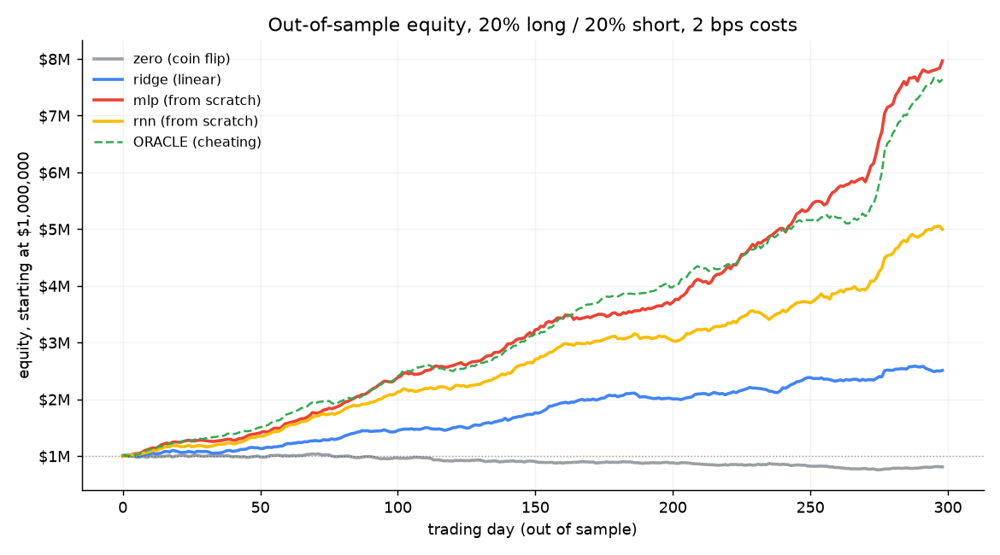

# Can you build AI models from scratch?

Yes. And you just did — everything in [`from_scratch/`](from_scratch) trains
without PyTorch, TensorFlow, JAX or scikit-learn. Only NumPy does arithmetic;
the automatic differentiation, the transformer, the optimiser and the
backtester are all local code you can read.

This folder is the long answer to two questions:

1. **How does a model get built from scratch?**
2. **Would a from-scratch stock-market analyser beat GPT?**

## The short answer

**Building a model is easy. Building a model that *knows* something is the hard
part.**

Any architecture is a few pages of maths: a matrix multiply, a nonlinearity,
and a loop that nudges numbers downhill. That is thirty lines. What makes a
model useful is *what it was trained on*. GPT is not magic attention layers —
it is a mostly ordinary transformer trained on a serious fraction of the text
humans have written, with months of engineering around the data, the
optimiser, and refusing to let it go insane mid-run.

**GPT is not the right competitor for a trading model.** GPT predicts the next
token. A market model predicts the next return. They are different jobs with
different data, and neither can do the other's job well:

| | Market model | GPT |
| --- | --- | --- |
| target | tomorrow's return | next token |
| signal-to-noise | ~0.5–5% explainable | ~everything is predictable |
| training data available | a few thousand noisy observations | trillions of clean tokens |
| ground truth | delayed, contested, non-stationary | next token, always known |
| failure mode | overfits a pattern that vanished | hallucination, stale knowledge |

A GPT asked "will this stock go up?" is guessing from text. It has never been
trained with a reward for calendrical accuracy, and financial text is mostly
already priced in. What GPT is genuinely good at in finance is the *language*
layer: reading filings, summarising news, writing the report around the
model. It is not a better alpha engine.

So no — a from-scratch model will not beat GPT at being GPT. But it can beat
an LLM at being a forecast, because it is trained on the actual job. That is
the only comparison that makes sense, and it is what the experiment below
measures.

## What's here

| File | What it teaches |
| --- | --- |
| [`nn.py`](nn.py) | an autograd engine + Adam in ~350 lines: Tensors, reverse-mode backprop, Linear/Embedding/LayerNorm |
| [`models.py`](models.py) | MLP, RNN, and **TinyGPT** — a real decoder-only transformer with causal self-attention |
| [`check_grad.py`](check_grad.py) | finite-difference gradient checks on every op and every model, plus learning sanity tests |
| [`finance.py`](finance.py) | the stock-market analyser: simulated market → features → four models → honest backtest |
| [`plot_finance.py`](plot_finance.py) | the two figures |
| [`torch_gpt.py`](torch_gpt.py) | the same transformer in PyTorch, for the scale comparison (optional) |
| [`results/`](results/) | JSON + PNG output of the last full run |

## Run it

```bash
./tools/setup_scratch.sh                     # venv + numpy + matplotlib
.venv/bin/python from_scratch/check_grad.py  # ~10 s: proves the gradients are right
.venv/bin/python from_scratch/finance.py     # ~4 min on 2 CPU cores, both worlds, 3 seeds
```

Everything runs on a laptop CPU. No GPU, no downloads, no API keys.

## The experiment, and what it shows

The market is simulated so the *true* signal is known. Prices have hidden
regimes (calm/normal/crisis), GARCH volatility clustering, fat-tailed shocks,
a common market factor, and one real effect:

> When a stock's recent volume has surged — attention is high, the trade is
> crowded — part of its last 5-day move **reverses** tomorrow. On quiet days
> it does not.

That is an *interaction*: move × attention. A linear model can only learn the
average of the two regimes, so it is wrong in both. Finding the interaction
requires a nonlinearity. That is the entire reason deep models can beat linear
factor models in practice.

Three seeds, 40 stocks × 2,000 days, strict 70/15/15 time split, 20% long /
20% short, 2 bps costs:

| model | params | R² (out-of-sample) | hit rate | rank IC | Sharpe | return |
| --- | ---: | ---: | ---: | ---: | ---: | ---: |
| zero (coin flip) | – | −0.002 ± 0.003 | 51.7% | −0.00 | −0.25 ± 0.83 | −3.5% |
| ridge (linear) | 150 | −0.002 ± 0.011 | 51.6% | +0.06 | 6.25 ± 0.71 | +189% |
| **mlp (from scratch)** | 7,683 | **+0.053 ± 0.007** | **53.7%** | **+0.14** | **13.30 ± 1.31** | **+915%** |
| rnn (from scratch) | 4,707 | +0.021 ± 0.009 | 52.6% | +0.11 | 10.68 ± 0.95 | +481% |
| oracle (cheating*) | – | +0.089 ± 0.003 | 73.6% | +0.14 | 13.72 ± 1.81 | +831% |
| buy & hold | – | – | – | – | 1.26 | |

\*The oracle knows the hidden truth, i.e. the theoretical best a perfect
forecaster could do. The R² ceiling for this world is +0.086, and the oracle
scores +0.089 — so the MLP captures **about 60% of everything that is
predictable**, and the linear model captures ~0%.





And the control that matters more than any of the above — the **same market
with the edge switched off**:

| model | R² with edge | R² with edge removed |
| --- | ---: | ---: |
| zero | −0.002 | −0.004 |
| ridge | −0.002 | −0.016 |
| mlp | **+0.053** | −0.005 |
| rnn | +0.021 | −0.017 |

The neural nets earn their keep *only* where an edge exists. On the control
they fall back to zero and below, and the buy-and-hold Sharpe (1.47) beats
every model's backtest. That is the honest signature of real skill: it
disappears when the signal does.

## The blunt caveats

- **This is a simulation, and that is the point.** On real tickers you cannot
  know the true conditional mean, so you cannot compute the ceiling. You would
  replace the simulator with a data loader and use walk-forward validation.
  The models, the split logic and the backtester are the same.
- **Any backtest that looks this good is usually broken.** Sharpe 13 is not a
  real-world result; it is what a clean, known signal in a closed world looks
  like. Real desks fight over Sharpe 0.3–0.8 and pay for it with slippage.
- **Costs matter more than architecture.** The backtest here charges 2 bps and
  measures turnover. In real markets, costs plus crowding are usually what
  kill a model, not the choice of layer type.
- **Feature engineering beat architecture.** The MLP needed the data reduced to
  a sane summary before it learned anything. The RNN saw the raw window and
  did worse. In practice, the representation matters more than the model.
- **Never trust one seed.** A single run of any of this can be luck. The
  numbers above are mean ± std over three independent worlds.

## If you want to go further, in order

1. **Write the transformer.** It is [`models.py`](models.py): `attention()` is
   scaled dot-product with a causal mask, and `Block` is attention + MLP around
   a residual stream. If that sentence is now clear, you understand GPT's
   architecture.
2. **Break it deliberately.** Delete the causal mask and watch the model cheat.
   Remove the residual connection and watch training collapse. The gradient
   check in `check_grad.py` will tell you when you did something wrong.
3. **Swap in real data.** `build_dataset()` takes a dict of returns and volume.
   Point it at any OHLCV source and the rest of the pipeline is unchanged.
4. **Then scale.** From 7k parameters to 7 billion, the maths does not change;
   what changes is data, parallelism, mixed precision, and how many months of
   compute you can pay for. That is what a frontier lab sells.

## Files in this folder

```
nn.py            autograd engine, ops, Module/Linear/Embedding/LayerNorm, Adam
models.py        MLP, RNN, TinyGPT (causal self-attention), cross-entropy
check_grad.py    finite-difference gradient checks + learning sanity tests
finance.py       the stock-market analyser and backtest
plot_finance.py  the two figures in results/
mini_gpt.py      trains a tiny GPT on a text file in ~2 seconds
torch_gpt.py     the same transformer in PyTorch, for scale comparison
results/         JSON metrics and PNGs from the last full run
```

The gradient checks are the file to read first if you want to trust any of
this: every operation is verified against a numeric derivative, and the
transformer is verified parameter-by-parameter.
